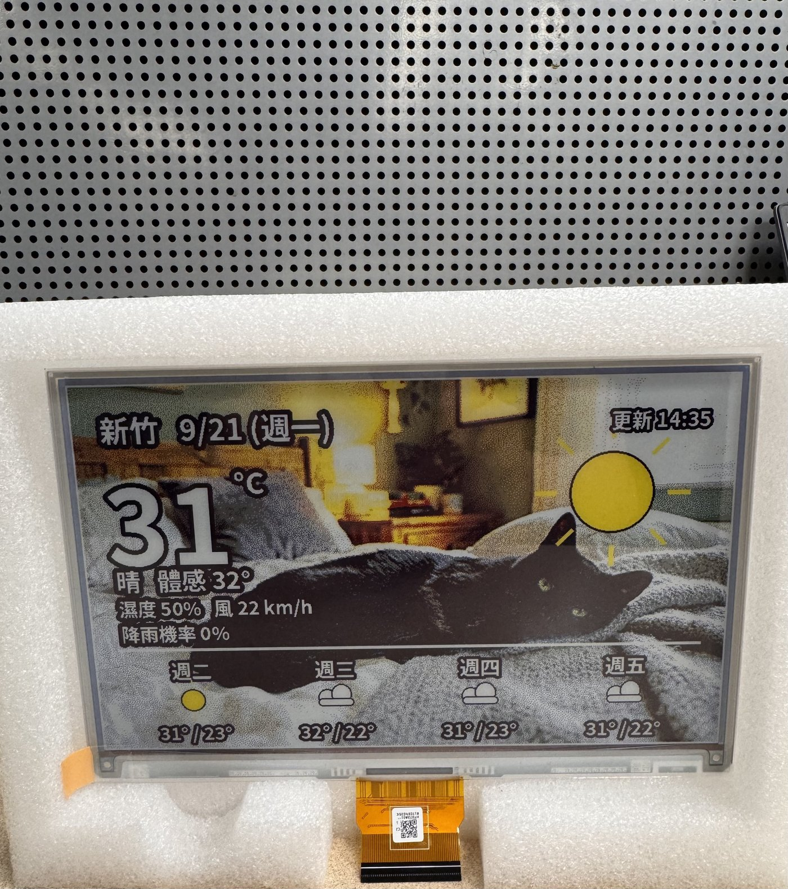
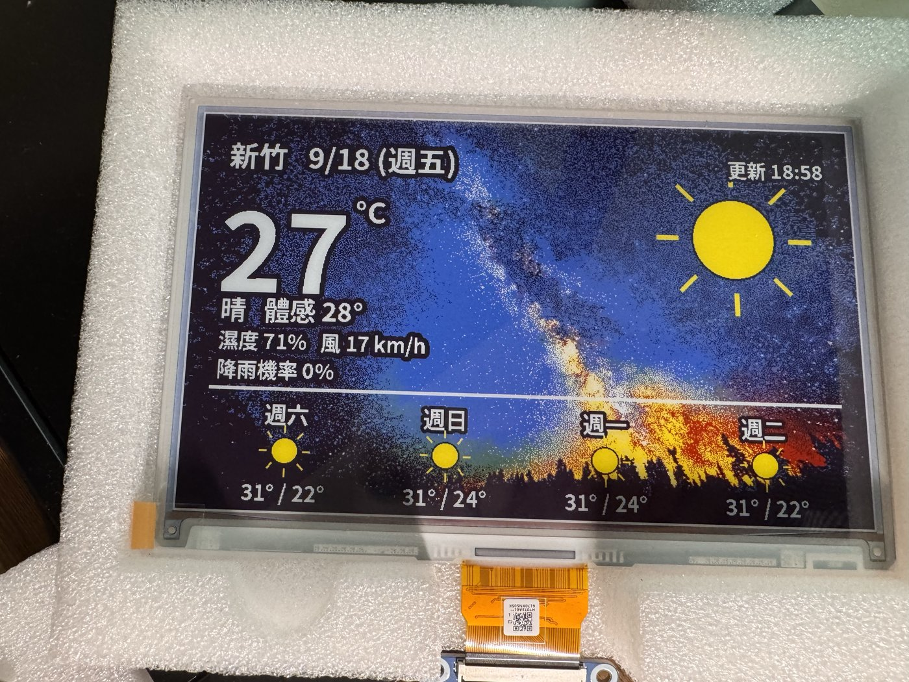
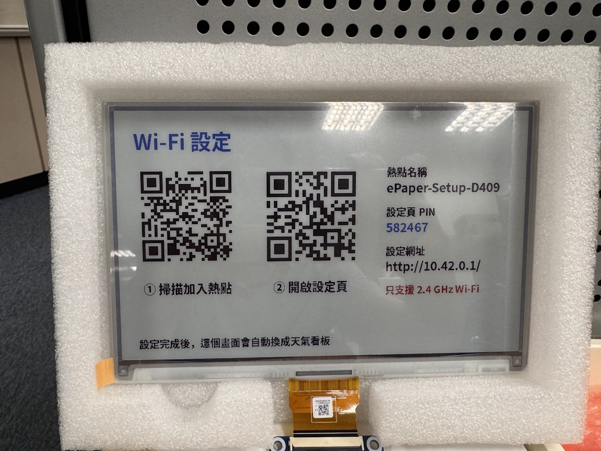

# 電子紙天氣相框｜家人使用說明書

[**點這裡開啟手機版圖文說明書**](https://crazylittlej.github.io/epaper-weather-dashboard/) · [**A6 小卡列印版**](https://crazylittlej.github.io/epaper-weather-dashboard/print-a6.html)

> 適用 [E-Paper Weather Dashboard v1.2.0](https://github.com/crazylittleJ/epaper-weather-dashboard)。這份說明是寫給日常使用者看的，不需要懂電腦。裝置原始設定與開發資訊請參考 [技術 README（繁體中文）](https://github.com/crazylittleJ/epaper-weather-dashboard/blob/main/README.zh-TW.md)。

## 相框實機成果

以下照片來自原專案的公開 README，展示照片背景與天氣資訊如何呈現在 7.3 吋全彩電子紙上。

> 這兩張是原 Repository 既有的「成果展示」照片。若要使用另外拍攝的組裝完成外觀照片，請將它放到 `docs/assets/finished-device.jpg`，並將此處及 `docs/index.html` 的圖片網址改成 `assets/finished-device.jpg`。

## 第一次使用：設定家中 Wi-Fi

**照片只是示意。真正設定時，請掃描自己的裝置螢幕；PIN 也要以當下螢幕顯示為準。**

1. **插電開機**：當裝置未連上網路時，等約 2 分鐘，螢幕會顯示「Wi-Fi 設定」。
2. **掃左邊 QR Code**：用手機掃描實機螢幕左側的 QR Code，加入 `ePaper-Setup-XXXX` 熱點。手機說「沒有網際網路」時，請保持連線。
3. **開啟設定網頁**：通常會自動跳出；若沒有，掃實機螢幕中間的 QR Code，或在瀏覽器輸入 `http://10.42.0.1/`。
4. **輸入設定**：選擇家中的 **2.4 GHz Wi-Fi**、輸入網路密碼、城市名稱及螢幕上的 **6 位數 PIN**，按下「連線」。
5. **等待完成**：手機可切回家中的 Wi-Fi，等待約 **1–4 分鐘**，看板會顯示天氣與照片。

> 提醒：Raspberry Pi 3 只支援 2.4 GHz Wi-Fi。Wi-Fi 設定熱點預設不加密，請在可信任的環境進行設定；PIN 用來防止未授權修改設定，但**不會加密傳送的 Wi-Fi 密碼**。

## 平常使用：換城市、換照片

1. 讓手機連上**和天氣相框相同的家中網路**。
2. 用手機瀏覽器開啟：**<http://epaper.local>**。
3. 可在裝置設定頁進行以下操作：
   - 搜尋城市、修改地點與顯示名稱。
   - 上傳或刪除背景照片，查看今天輪到哪張。
   - 按「立即更新畫面」。
   - 重新設定 Wi-Fi（換家中路由器或密碼時）。
   - 閱讀裝置內建說明：<http://epaper.local/help>。

> `epaper.local` 是裝置區域網路位址，並不是公開的網頁；人在外面或使用行動數據時，通常無法開啟。如果主機名稱有修改，網址也會不同。

## 常見問題

**Q：手機連上 ePaper-Setup 卻顯示「沒有網際網路」？** 這是正常的，因為這個 Wi-Fi 是設定相框用的暫時熱點。保持連線後，再開 `http://10.42.0.1/`。

**Q：找不到家中 Wi-Fi？** 請確認 2.4 GHz 頻段已開啟。只提供 5 GHz 的 Wi-Fi 無法連線。

**Q：PIN 不正確？** 請看實機目前顯示的 6 位數 PIN，不是照片範例。連錯 5 次會暫停 5 分鐘。

**Q：設定成功後沒有馬上顯示天氣？** 請先等 1–4 分鐘；若裝置重新顯示 Wi-Fi 設定畫面，再加入熱點並查看錯誤原因。

**Q：`epaper.local` 打不開？** 檢查手機是否使用相同區網，或透過路由器找到裝置 IP 位址，輸入 `http://裝置IP`。

**Q：畫面偶爾閃爍或沒有立刻更新？** 電子紙完整刷新約需 25 秒，閃爍正常。裝置每小時檢查是否更新，內容無變化時可能略過刷新。

## 列印 QR Code 說明小卡

- 開啟 [A6 列印版](https://crazylittlej.github.io/epaper-weather-dashboard/print-a6.html)。
- 用瀏覽器列印，紙張選 **A6 直式（105 × 148 mm）**，縮放 100%。
- 裁切後貼在相框背面，家人掃描小卡就能打開這份最新說明書。
- **小卡的 QR Code 用來開公開說明書，不是連上裝置 Wi-Fi 的 QR Code。**

---

[原始 GitHub 專案](https://github.com/crazylittleJ/epaper-weather-dashboard) · [技術 README（繁體中文）](https://github.com/crazylittleJ/epaper-weather-dashboard/blob/main/README.zh-TW.md)
